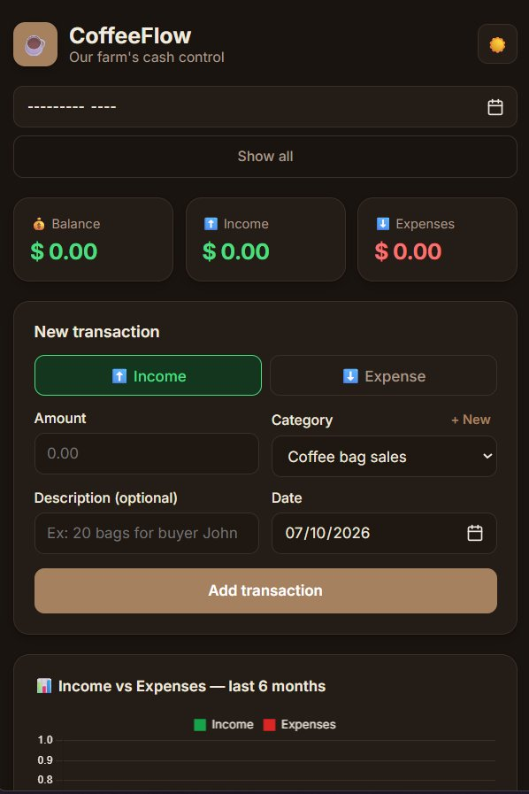
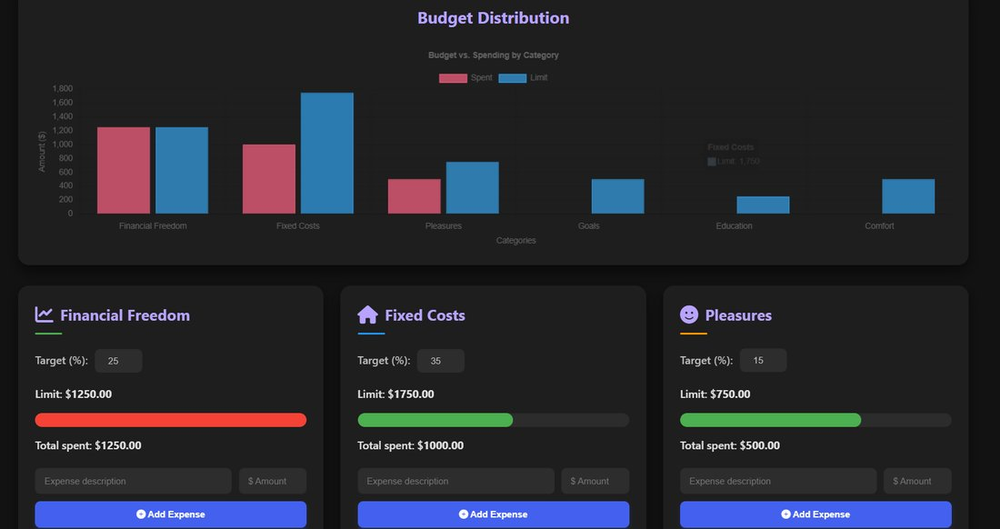
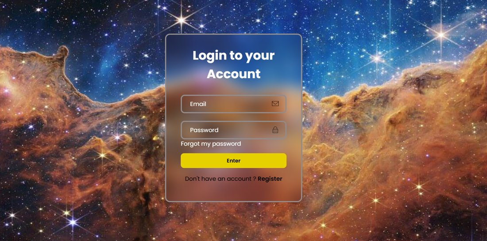

# Wenner Nunes
### Front-End Developer · Digital Consultant

*"Do. Or do not. There is no try."* — Yoda

---

## 🌌 A long time ago, in a garden far, far away...

For eight years I ran my own gardening business in England — planning projects, managing clients and delivering work people could see and touch. In 2025 I made the jump to tech, bringing the same values with me: **patience, attention to detail and a focus on real results for real people.**

Today I build clean, responsive and user-friendly websites, and help small businesses improve their digital presence through SEO and online marketing.

This repository is my personal portfolio — a Star Wars themed space where you can explore my projects, my journey and download my CV.

---

## 🚀 Featured Projects

<table>
  <tr>
    <td width="33%" align="center">
      
      <h3>☕ CoffeeFlow</h3>
      
A web app designed to help manage a coffee business.

      <a href="https://coffeeflowapp.netlify.app"><strong>View live demo →</strong></a>
    </td>
    <td width="33%" align="center">
      
      <h3>💰 Household Budget</h3>
      
A tool to organise and track household income and expenses.

      <em>Live demo coming soon</em>
    </td>
    <td width="33%" align="center">
      
      <h3>🪐 Space Login</h3>
      
A space-themed login page developed as a <strong>paid project for a client</strong>.

      <em>Client work</em>
    </td>
  </tr>
</table>

---

## 🛠️ Tech Stack

**This portfolio is built with:**

**Other tools and technologies I work with:**

---

## 📚 Currently Training

- 🟢 **Node.js** and **SQL** — growing towards full-stack development
- 🛡️ **Cybersecurity** — Introduction to Cybersecurity (Cisco Networking Academy)
- 🎓 **Full-stack course** — Sujeito Programador

---

## 🎓 Background

- **BA in History** — Federal University of Espírito Santo (UFES), Brazil
- **Front-End Development** — Sujeito Programador
- **8 years running my own business** — client management, planning and delivery

---

## 💻 Run Locally

    git clone https://github.com/WennerNunes/portfolio.git
    cd portfolio

Then open `index.html` in your browser. No installation needed.

---

### 📫 Let's work together

I'm open to front-end roles and freelance projects.

**wennerluiz6@gmail.com** · [LinkedIn](https://www.linkedin.com/in/wenner-luiz-santana-nunes-122712205/) · [GitHub](https://github.com/WennerNunes)

*May the Force be with you.* ⚔️

